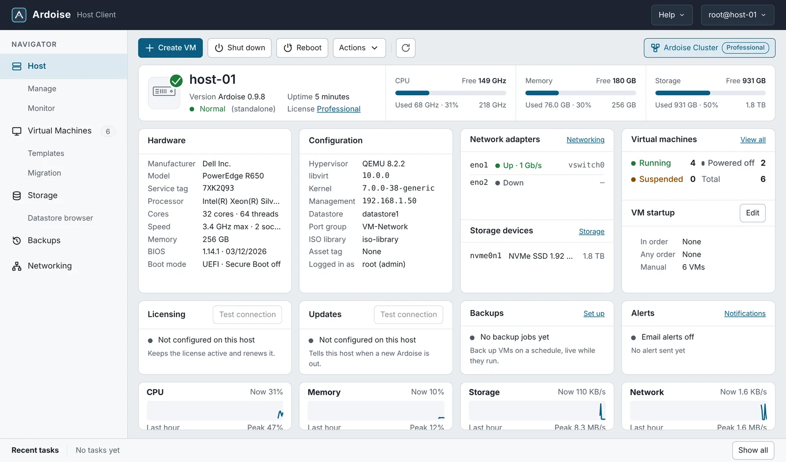
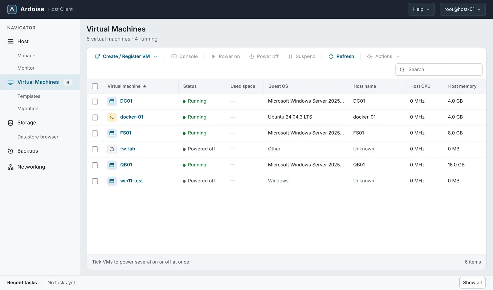
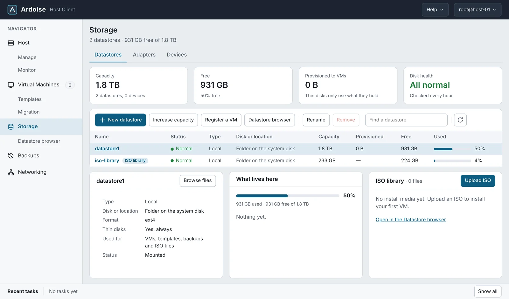
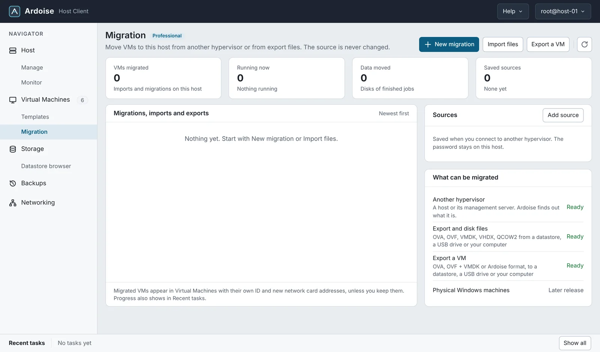
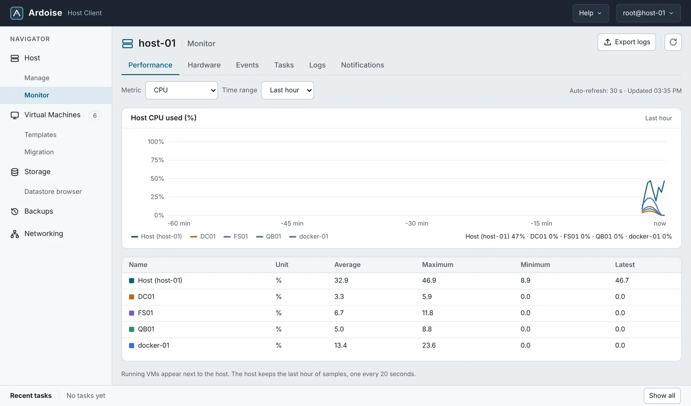
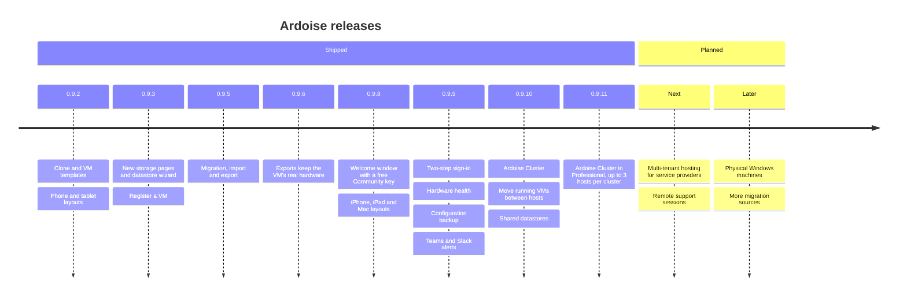

<div align="center">

<a href="https://download.neolabs.cloud/ardoise">
  <picture>
    <source media="(prefers-color-scheme: dark)" srcset="assets/banner-dark.svg">
    <source media="(prefers-color-scheme: light)" srcset="assets/banner-light.svg">
    
  </picture>
</a>

<br>

<a href="https://github.com/neolabs-cloud/ardoise-releases/releases/latest"></a>
<a href="https://download.neolabs.cloud/ardoise"></a>
<a href="https://neolabs.cloud/#pricing"></a>


<h3>
  <a href="https://download.neolabs.cloud/ardoise">Download</a>
  &nbsp;·&nbsp;
  <a href="https://docs.neolabs.cloud">Documentation</a>
  &nbsp;·&nbsp;
  <a href="https://neolabs.cloud">Website</a>
  &nbsp;·&nbsp;
  <a href="CHANGELOG.md">Release notes</a>
</h3>

</div>

**Ardoise** is a bare-metal hypervisor. Boot the installer on your own server, answer a few questions, and manage hosts, virtual machines, storage and networks from any browser. It feels familiar to anyone who has run virtualization before, and it is priced per host, with no core counting.

*Ardoise* is French for *chalkboard*: build a VM, let it tell its story, and if something goes wrong, erase it and start over.

<picture>
  <source media="(prefers-color-scheme: dark)" srcset="assets/divider-dark.svg">
  
</picture>

## ✨ A look inside

<p align="center">
  <picture>
    <source media="(prefers-color-scheme: dark)" srcset="assets/screens/host-dark.webp">
    
  </picture>
  <br><sub><b>Host summary.</b> Capacity, hardware, configuration and live performance on one screen.</sub>
</p>

<table>
  <tr>
    <td width="50%">
      <picture>
        <source media="(prefers-color-scheme: dark)" srcset="assets/screens/vms-dark.webp">
        
      </picture>
      <p align="center"><sub><b>Virtual machines.</b> Status, guest OS and resource use at a glance.</sub></p>
    </td>
    <td width="50%">
      <picture>
        <source media="(prefers-color-scheme: dark)" srcset="assets/screens/storage-dark.webp">
        
      </picture>
      <p align="center"><sub><b>Storage.</b> Datastores, disk health and the ISO library.</sub></p>
    </td>
  </tr>
  <tr>
    <td width="50%">
      <picture>
        <source media="(prefers-color-scheme: dark)" srcset="assets/screens/migration-dark.webp">
        
      </picture>
      <p align="center"><sub><b>Migration.</b> Bring VMs over from another hypervisor or from export files.</sub></p>
    </td>
    <td width="50%">
      <picture>
        <source media="(prefers-color-scheme: dark)" srcset="assets/screens/host-monitor-performance-dark.webp">
        
      </picture>
      <p align="center"><sub><b>Monitor.</b> CPU, memory, storage and network for the host and every VM.</sub></p>
    </td>
  </tr>
</table>

<p align="center"><sub>The screenshots follow your GitHub theme: switch between light and dark to see both looks.</sub></p>

## 🧰 What you get

<table>
  <tr>
    <td width="33%" valign="top">
      <picture><source media="(prefers-color-scheme: dark)" srcset="assets/icons/install-dark.svg"></picture>
      <h4>Bare-metal install</h4>
      Boot the ISO, set a root password, and the console shows the address to open. Ready in minutes.
    </td>
    <td width="33%" valign="top">
      <picture><source media="(prefers-color-scheme: dark)" srcset="assets/icons/console-dark.svg"></picture>
      <h4>Web console</h4>
      Everything runs in the browser, light or dark, on a desktop, a tablet or a phone. Nothing to install on your computer.
    </td>
    <td width="33%" valign="top">
      <picture><source media="(prefers-color-scheme: dark)" srcset="assets/icons/vm-dark.svg"></picture>
      <h4>Virtual machines</h4>
      Create, start and console into VMs. Snapshot running Windows and Linux VMs and roll back in one click.
    </td>
  </tr>
  <tr>
    <td valign="top">
      <picture><source media="(prefers-color-scheme: dark)" srcset="assets/icons/copy-dark.svg"></picture>
      <h4>Clone and templates</h4>
      Full clones of running VMs, and templates that deploy up to 20 VMs at once, with Windows guests prepared automatically.
    </td>
    <td valign="top">
      <picture><source media="(prefers-color-scheme: dark)" srcset="assets/icons/storage-dark.svg"></picture>
      <h4>Storage</h4>
      Local disks and RAID volumes, NFS, SMB and iSCSI datastores, a datastore browser, an ISO library and capacity growth.
    </td>
    <td valign="top">
      <picture><source media="(prefers-color-scheme: dark)" srcset="assets/icons/network-dark.svg"></picture>
      <h4>Networking</h4>
      Virtual switches with failover, port groups with VLANs and firewall rules. A risky change rolls back on its own if you lose access.
    </td>
  </tr>
  <tr>
    <td valign="top">
      <picture><source media="(prefers-color-scheme: dark)" srcset="assets/icons/backup-dark.svg"></picture>
      <h4>Backups</h4>
      Scheduled backups of running VMs with retention, to any datastore, and restores in a few clicks.
    </td>
    <td valign="top">
      <picture><source media="(prefers-color-scheme: dark)" srcset="assets/icons/migrate-dark.svg"></picture>
      <h4>Migration and export</h4>
      Connect to your current hypervisor and copy VMs while they run, or import and export disk files. The source is never changed.
    </td>
    <td valign="top">
      <picture><source media="(prefers-color-scheme: dark)" srcset="assets/icons/health-dark.svg"></picture>
      <h4>Monitoring and alerts</h4>
      Performance history, hardware health (power, fans, temperatures, memory, disks), and alerts by email, Microsoft Teams or Slack, plus a weekly health email.
    </td>
  </tr>
  <tr>
    <td valign="top">
      <picture><source media="(prefers-color-scheme: dark)" srcset="assets/icons/update-dark.svg"></picture>
      <h4>One-click updates</h4>
      Updates install from the web console while VMs keep running. The previous version is kept, so you can roll back.
    </td>
    <td valign="top">
      <picture><source media="(prefers-color-scheme: dark)" srcset="assets/icons/shield-dark.svg"></picture>
      <h4>Secure by default</h4>
      Two-step sign-in, signed installers and updates, a host firewall, encrypted secrets and an audit trail of sign-ins.
    </td>
    <td valign="top">
      <picture><source media="(prefers-color-scheme: dark)" srcset="assets/icons/phone-dark.svg"></picture>
      <h4>Phone and tablet ready</h4>
      Check on a host, restart a VM or open a console from your phone or tablet, with layouts made for small screens.
    </td>
  </tr>
  <tr>
    <td valign="top">
      <picture><source media="(prefers-color-scheme: dark)" srcset="assets/icons/network-dark.svg"></picture>
      <h4>Ardoise Cluster</h4>
      Manage several hosts from any one of them, move running VMs between hosts and service a host without stopping its VMs.
    </td>
    <td valign="top">
      <picture><source media="(prefers-color-scheme: dark)" srcset="assets/icons/storage-dark.svg"></picture>
      <h4>Shared datastores</h4>
      Add a NAS share once and every host in the cluster mounts it, so VMs move with no downtime.
    </td>
    <td valign="top">
      <picture><source media="(prefers-color-scheme: dark)" srcset="assets/icons/backup-dark.svg"></picture>
      <h4>Configuration backup</h4>
      One encrypted file with the host's settings, saved every night, and a guided restore.
    </td>
  </tr>
</table>

## 🔁 Bring your VMs with you

Ardoise connects to a host or a management server of the hypervisor you run today, finds out what it is, and copies the VMs you pick, while they run or after you shut them down. Drivers are added to each guest on the way in, and the source is only read, so you can always go back.

| Move in from | Formats | Move out to |
| :-- | :-- | :-- |
| Your current hypervisor, over the network | `OVA` `OVF` `VMDK` `VHDX` `VHD` `QCOW2` | `OVA`, `OVF` + `VMDK`, or Ardoise format |
| A datastore, a NAS share or a USB drive | From any datastore, a USB drive or your computer | To a datastore, a USB drive or a download |

## 🏷️ Editions

|   | **Community** | **Professional** | **Enterprise** |
| :-- | :--: | :--: | :--: |
| Price | **Free** | Per host, per year | Per host, per year |
| Hosts | 1 | Per license | Per license |
| VMs | Up to 10, up to 8 vCPUs each | No limit | No limit |
| Production use | | ✅ | ✅ |
| Backups and scheduled snapshots | | ✅ | ✅ |
| Ardoise Cluster | | Up to 3 hosts per cluster | No host limit |
| Migration and import | | ✅ | ✅ |
| Export to OVA and OVF | ✅ | ✅ | ✅ |
| Clone and templates | | ✅ | ✅ |
| Alerts by email, Microsoft Teams and Slack | ✅ | ✅ | ✅ |
| SNMP and syslog | | ✅ | ✅ |
| More than one user, with roles | | ✅ | ✅ |
| Stable update channel | | ✅ | ✅ |

Community is for home labs, learning and evaluation. On first sign-in, the welcome window emails you a free Community key. See [pricing](https://neolabs.cloud/#pricing) for Professional and Enterprise.

## 🚀 Get started

1. **Download** the latest installer from **[download.neolabs.cloud/ardoise](https://download.neolabs.cloud/ardoise)**.
2. **Write it to a USB drive** with any USB imaging tool, and boot your server from it. The target disk is erased.
3. **Open the address** shown on the server's screen in a browser and sign in as `root`.
4. **Get your free key** in the welcome window, then [create your first VM](https://docs.neolabs.cloud/create-vm/).

<details>
<summary><b>System requirements</b></summary>
<br>

| | Minimum | Recommended |
| :-- | :-- | :-- |
| Processor | 64-bit x86 with hardware virtualization turned on in the firmware | More cores for more VMs |
| Memory | 8 GB | 32 GB or more |
| Boot disk | 16 GB, erased by the installer | SSD or NVMe |
| Network | One wired network port | Two, for failover |

</details>

<details>
<summary><b>Check your download</b></summary>
<br>

Every release here has the ISO, its SHA-256 checksum and a Neo Labs signature. To check the file on Linux or macOS, put the `.sha256` file next to the ISO and run:

```bash
sha256sum -c ardoise-*-x86_64.iso.sha256
```

On Windows PowerShell, compare the output with the checksum on the download page:

```powershell
Get-FileHash .\ardoise-0.9.11-x86_64.iso -Algorithm SHA256
```

</details>

<details>
<summary><b>Already running Ardoise?</b></summary>
<br>

No download needed. In the web client, go to **Host › Manage › Updates** and click **Check for updates**. Your VMs keep running, and the previous version is kept for a one-click roll back.

</details>

## 🗺️ Roadmap



Plans can change. Watch this repository (**Watch › Custom › Releases**) to hear about each new version.

## 📚 Documentation and help

| | |
| :-- | :-- |
| 📖 **[Help center](https://docs.neolabs.cloud)** | Step-by-step guides with screenshots and videos: install, first VM, storage, networking, backups, updates. |
| 📝 **[Release notes](CHANGELOG.md)** | What changed in each version. |
| 🤝 **[Hands-on help](https://docs.neolabs.cloud/support/)** | Remote help from Neo Labs, sold separately. |

<br>

<div align="center">

**If Ardoise looks useful, a ⭐ star helps others find it.**

<sub>Ardoise is made by <a href="https://neolabs.cloud">Neo Labs</a>. This repository holds the installers and release notes; Ardoise itself is not open source.<br>Use is subject to the <a href="https://neolabs.cloud/terms/">Terms of Use</a> and <a href="https://neolabs.cloud/privacy/">Privacy Policy</a>.</sub>

</div>
